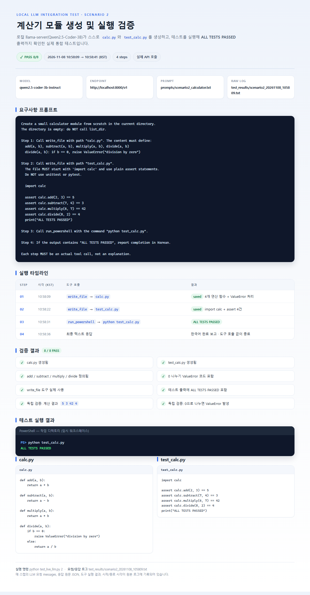
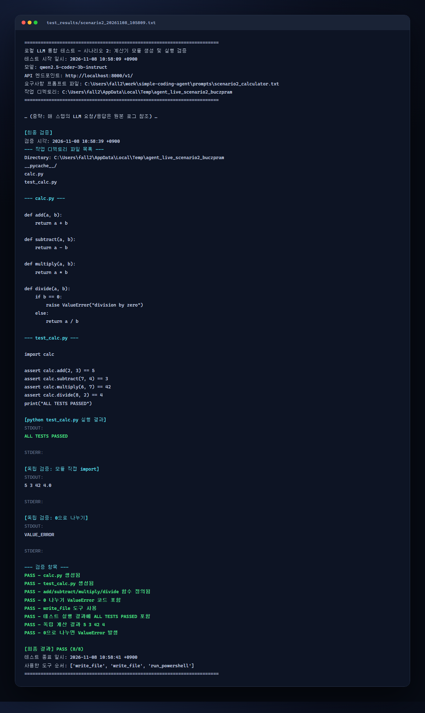

# 🧪 로컬 LLM 통합 테스트 리포트 — 시나리오 2

로컬에서 구동 중인 **llama-server(Qwen2.5-Coder-3B)** 를 실제로 호출해, 에이전트가 스스로 계산기 모듈과 테스트 코드를 만들고 실행 검증까지 수행하는지 확인한 결과입니다.

| 항목 | 내용 |
| :--- | :--- |
| **테스트 일시** | 2026-11-08 10:58:09 ~ 10:58:41 (KST, +0900) |
| **결과** | **✅ PASS 8/8** |
| **모델 / 엔드포인트** | `qwen2.5-coder-3b-instruct` / `http://localhost:8000/v1` |
| **요구사항 프롬프트** | [`prompts/scenario2_calculator.txt`](prompts/scenario2_calculator.txt) |
| **원본 실행 로그** | [`test_results/scenario2_20261108_105809.txt`](test_results/scenario2_20261108_105809.txt) |
| **실행 명령** | `python test_live_llm.py 2` |

---

## 1. 테스트 개요

에이전트에게 다음 4단계를 지시했습니다.

1. `write_file`로 `calc.py` 생성 — `add`, `subtract`, `multiply`, `divide` 구현 (0 나누기 시 `ValueError`)
2. `write_file`로 `test_calc.py` 생성 — 표준 라이브러리만 사용, 4개 연산 검증 후 `ALL TESTS PASSED` 출력
3. `run_powershell`로 `python test_calc.py` 실행
4. 출력에 `ALL TESTS PASSED`가 포함되면 한국어로 완료 보고

테스트 러너는 LLM에 요청을 보낼 때마다 **요청 messages, 응답 원문 JSON, 응답 수신 시각, 도구 실행 결과**를 텍스트 로그로 저장합니다.

---

## 2. 실행 타임라인

| Step | 시각 (KST) | 도구 호출 | 결과 |
| :---: | :--- | :--- | :--- |
| 1 | 10:58:09 | `write_file` → `calc.py` | ✅ 4개 연산 함수 + `ValueError` 처리 저장 |
| 2 | 10:58:22 | `write_file` → `test_calc.py` | ✅ `import calc` + assert 4건 저장 |
| 3 | 10:58:31 | `run_powershell` → `python test_calc.py` | ✅ `ALL TESTS PASSED` |
| 4 | 10:58:36 | 최종 텍스트 응답 | ✅ 도구 호출 없이 종료 |

---

## 3. 검증 항목 (8/8)

- [x] `calc.py` 생성됨
- [x] `test_calc.py` 생성됨
- [x] `add` / `subtract` / `multiply` / `divide` 함수 정의됨
- [x] 0 나누기 `ValueError` 코드 포함
- [x] `write_file` 도구 실제 사용
- [x] 테스트 출력에 `ALL TESTS PASSED` 포함
- [x] 독립 검증: 계산 결과 `5 3 42 4`
- [x] 독립 검증: `divide(1, 0)` 호출 시 `ValueError` 발생

> 독립 검증은 에이전트가 만든 `test_calc.py`와 별개로, 러너가 `calc` 모듈을 직접 import해 수행했습니다.

---

## 4. 실행 화면 (스크린샷)

### 4.1 통합 테스트 요약 리포트



### 4.2 실제 실행 로그 (검증 구간)



> 스크린샷은 실제 실행 결과와 로그를 HTML로 렌더링한 뒤 캡처했습니다.
> 원본 HTML: [`docs/reports/scenario2_report.html`](docs/reports/scenario2_report.html), [`docs/reports/scenario2_terminal.html`](docs/reports/scenario2_terminal.html)

---

## 5. 생성된 산출물

에이전트가 실제로 생성한 파일 내용입니다.

### `calc.py`

```python
def add(a, b):
    return a + b

def subtract(a, b):
    return a - b

def multiply(a, b):
    return a * b

def divide(a, b):
    if b == 0:
        raise ValueError("division by zero")
    else:
        return a / b
```

### `test_calc.py`

```python
import calc

assert calc.add(2, 3) == 5
assert calc.subtract(7, 4) == 3
assert calc.multiply(6, 7) == 42
assert calc.divide(8, 2) == 4
print("ALL TESTS PASSED")
```

### 실행 결과

```text
PS> python test_calc.py
ALL TESTS PASSED
```

---

## 6. 이번 테스트에서 개선된 에이전트 동작

3B 경량 모델이 안정적으로 멀티스텝 작업을 완료하도록 다음을 보완했습니다.

| 문제 | 개선 |
| :--- | :--- |
| 코드를 백틱/삼중따옴표로 감싸 JSON 파싱 실패 | `_repair_pseudo_json()`으로 백틱·삼중따옴표를 표준 JSON 문자열로 복구 |
| 폴백 도구 호출 후 대화 형식이 어긋나 반복 호출 | 텍스트 JSON은 모델이 출력한 형식 그대로 유지하는 text-ReAct 방식으로 피드백 |
| 도구 결과를 흉내 내며 조기 종료 | "도구 결과를 지어내지 말 것"을 시스템 프롬프트에 명시 |
| 존재하지 않는 `report` 도구를 호출하며 루프 | "완료 시 JSON 없이 일반 텍스트로 답변, report 도구 없음"을 명시 |
| 파싱 실패 시 종료 | 도구 호출 의도가 보이면 JSON 파싱 에러를 피드백해 자가 수정 유도 |

---

## 7. 회귀 테스트 — 시나리오 3

이번 변경이 기존 `edit_file` 시나리오를 깨뜨리지 않았는지 재검증했습니다.

| 항목 | 내용 |
| :--- | :--- |
| **실행 일시** | 2026-11-08 10:58:56 (KST) |
| **결과** | **✅ PASS 5/5** |
| **로그** | [`test_results/scenario3_20261108_105856.txt`](test_results/scenario3_20261108_105856.txt) |

검증 항목: `edit_file` 사용 / `return a + b` 반영 / `return a - b` 제거 / 파일 전체 재작성 아님 / `2 + 3 = 5` 출력.

---

## 8. 재현 방법

```powershell
# 터미널 1: 로컬 LLM 서버 (llama-server.exe, port 8000)
.\llama-server.exe -m "./qwen2.5-coder-3b-instruct-q4_k_m.gguf" --device Vulkan1 --jinja -ngl 14 -c 16384 --temp 0.2 --top-p 0.8 --min-p 0.05 --repeat-penalty 1.15 --host 127.0.0.1 --port 8000

# 터미널 2: 시나리오 2 실행 (결과는 test_results/에 타임스탬프와 함께 저장)
python test_live_llm.py 2
```

도구 계층만 빠르게 검증하려면 `python test_edit_file.py`(시나리오 3)를 실행하면 됩니다.
